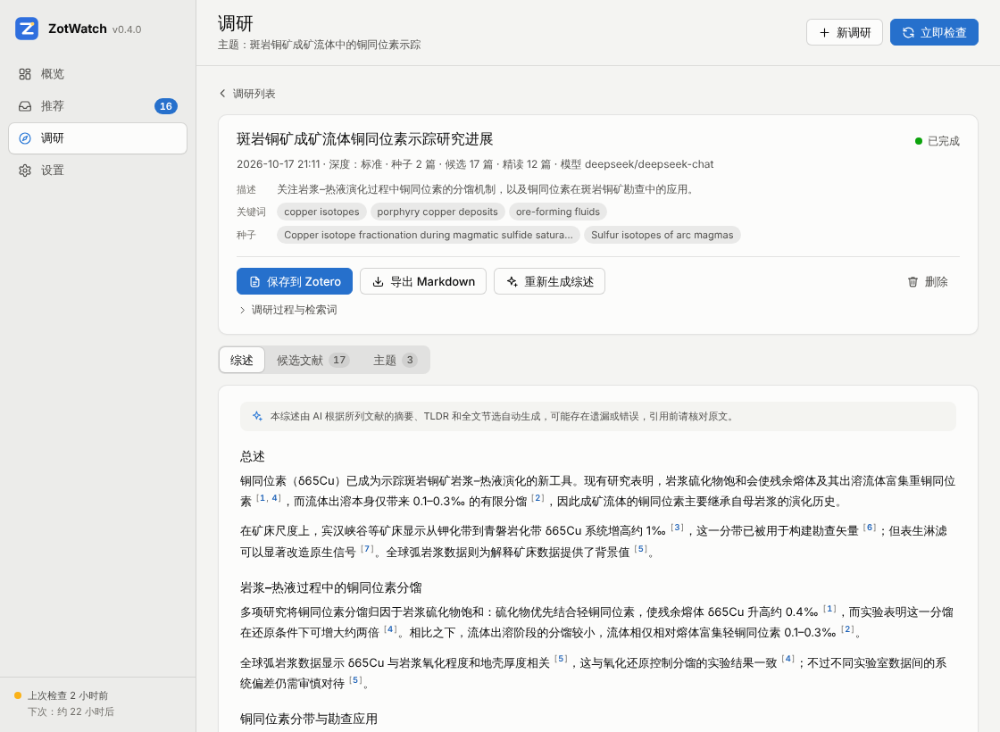

# ZotWatch for Zotero（Zotero 插件版）

把 [AIZotWatch](../README.md) 的「根据文库推荐新文献」功能直接做进 Zotero：插件读取你本地的 Zotero 文库构建研究画像，每天自动从 Crossref / arXiv / EarthArXiv 抓取最新论文，按与文库的语义相关性打分排序，在 Zotero 里直接浏览、一键加入文库。

不再需要 GitHub Actions、Zotero Web API Key 或服务器——Zotero 开着就能用。

## 功能

- **本地文库画像**：直接读取 Zotero 本地数据库中的条目（无需 Zotero API Key），增量向量化——只有新增或修改过的条目才会重新计算
- **多源抓取**：Crossref（按关注期刊 ISSN）、arXiv（按分类）、EarthArXiv（OAI-PMH）
- **摘要补全**：论文缺少摘要时（很多出版商不向 Crossref 提交摘要），按 DOI 依次从 Crossref、Elsevier、Springer Nature（后两者需填写免费的 API Key）、OpenAlex 和 Semantic Scholar（需填写 Key，同时提供 TLDR 一句话总结）查找，结果缓存在本地；关注作者的论文同样会补全
- **学术数据接口**：填写 OpenAlex（2026 年起需要免费 Key）和 Semantic Scholar 的 API Key；所有请求按服务自动限速（如 Semantic Scholar 每秒 1 次），遇到限流时等待后重试
- **关注期刊**：默认取文库中最常出现的期刊作为关注列表；可以在 OpenAlex 中按刊名或 ISSN 搜索添加，或「从文库生成」一份建议（文库常见期刊 + 启用大模型时推荐的相关期刊，均经 OpenAlex 核实）勾选后加入，学科和近似影响因子（OpenAlex 两年均被引）自动填写；也可导入 `journal_whitelist.csv`（含影响因子）
- **与 Python 版一致的打分算法**：k-NN 微观相似度 + 语义聚类宏观相似度融合（Silhouette 自适应选 k），叠加期刊影响因子，动态阈值分出「必读 / 推荐 / 一般」
- **顶刊地学速览**：Nature、Science、PNAS、Nature Communications、Science Advances 等综合性顶刊单独抓取，不按文库相似度筛选，而是用语义「领域锚点」挑出其中的固体地球科学与古生物文章（介于两可之间的可交给大模型复核），单独列出（每次取最新发表的 N 篇）
- **关注作者**：按 ORCID（或 OpenAlex 作者 ID）追踪指定研究者的新论文，可在 OpenAlex 中按姓名搜索后一键关注。这些论文不参与打分、只与文库去重，每篇只出现一次；与个性推荐重合时不重复显示，而是在那条推荐上标注「关注：作者名」
- **概览仪表盘**：待查看篇数、本次新增与必读、最近 14 次运行的新增推荐、筛选漏斗、各数据源状态、研究方向和关注作者一目了然
- **推荐收件箱**：「待查看 / 已加入 / 已忽略」三栏，已处理的论文不会重复推荐；按来源分区显示（个性推荐、顶刊地学、关注作者），支持按来源筛选、筛选必读、本次新增、按分数/日期排序、搜索
- **一键加入 Zotero**：通过 DOI / arXiv 号调用 Zotero 自带的「通过标识符添加」抓取完整元数据，自动放入指定分类并打标签
- **AI 增强（可选）**：标题翻译成中文、五要点结构化 AI 摘要（研究问题 / 方法 / 发现 / 创新点 / 相关性），可保存为子笔记；支持任何 OpenAI 兼容接口（OpenRouter、DeepSeek、Kimi、通义千问…）
- **研究方向标签（需大模型）**：文库语义聚类得到的每个研究方向由大模型根据代表性标题和你的 Zotero 标签起一个简短的中文名称，每篇推荐（含顶刊地学文章）标注它最接近的研究方向「方向：…」；标签只生成一次，之后按方向成员沿用，文库变化后只为新出现的方向补充
- **主题文献调研**：输入一个主题、几个关键词，或在文库中选几篇「种子文献」，插件沿参考文献、施引文献、Semantic Scholar 推荐和关键词检索（OpenAlex / Semantic Scholar / Crossref）扩展出候选文献池，按与主题和种子的相关性排序；启用大模型时精读排名靠前的论文，按主题聚类后写出一篇带编号引用 [n] 的中文综述（引用逐条核对，只能引用精读过的文献），可保存为 Zotero 笔记并把引用的文献一起放进分类，或导出 Markdown
- **每日自动运行**：Zotero 运行时在后台按间隔检查，发现新推荐时弹出提示
- **开箱即用**：默认使用无需 API Key 的本地向量化模式；配置 DashScope / Voyage 后推荐质量更高

## 安装

支持 **Zotero 7、8、9、10**（已对照 Zotero 7.0 / 10.0 源码逐项核对所用接口）。在 Zotero 9 及以上版本中，菜单通过官方的 `Zotero.MenuManager` 注册（带图标，随界面语言显示中文或英文）；Zotero 7、8 上则直接在「工具」菜单中插入纯文本菜单项（这两个版本里插件的本地化文件会影响主窗口其他文字的语言，所以不使用）。两种方式下菜单项都会显示待查看推荐的数量。

1. 下载 `.xpi` 文件：
   - 正式版本：仓库的 [Releases](https://github.com/CrazyHalfDay/AIZotWatch/releases) 页面（`zotero-plugin-v*` 标签）
   - 最新构建：仓库 Actions 中的「Zotero Plugin」工作流 → 最近一次运行 → Artifacts → `zotwatch-xpi`（下载后先解压出 `.xpi`）
   - 或自行构建，见下文「开发」
2. Zotero → 工具 → 插件（Plugins）→ 右上角齿轮 → 「从文件安装插件…」（Install Plugin From File…）→ 选择 `.xpi`

## 快速上手

1. 安装后打开 **工具 → ZotWatch 文献推荐…**（或 Zotero 设置 → ZotWatch → 「打开设置」），在 ZotWatch 窗口左侧点 **设置**：
   - **向量化**：推荐选择「阿里云 DashScope」并填入 API Key（与 AIZotWatch 的 `DASHSCOPE_API_KEY` 相同），点「测试向量化」确认可用；不填也能用本地模式
   - **学术数据接口**：在 [openalex.org](https://openalex.org) 免费注册并填写 OpenAlex API Key（期刊和作者搜索、关注作者、摘要补全和调研都要用到，见下文「学术数据接口」）；建议同时填写 Crossref 联系邮箱，进入 Crossref 的礼貌池，请求更稳定
   - **关注期刊**：默认自动关注文库中最常见的 40 种期刊；也可以在搜索框中按刊名或 ISSN 添加，点「从文库生成」挑选建议的期刊，点「导入 CSV…」导入 AIZotWatch 的 `data/journal_whitelist.csv`，或点「载入地学期刊示例」
2. 点窗口右上角的 **「立即检查」**，或使用菜单 **工具 → ZotWatch：立即检查新文献**
3. 首次运行需要向量化整个文库（几千篇文献约几分钟，取决于 API 速度），之后每天只处理新增内容
4. 在 ZotWatch 窗口的 **推荐** 页浏览推荐，点「加入 Zotero」或「忽略」

## 概览

左侧栏第一项 **概览**（快捷键 Ctrl/⌘+1）汇总文库和最近几次检查的情况。从 Zotero 设置 → ZotWatch →「打开 ZotWatch」进入时显示概览；「工具 → ZotWatch 文献推荐…」打开的是推荐页，随时可以切换过来：


- **待查看**：推荐页中还没处理的篇数，按个性推荐 / 顶刊地学 / 关注作者细分，并标出其中的必读篇数；旁边四项指标为上次检查新增的推荐（按来源细分）、其中的必读、已加入 Zotero 的篇数（已处理的记录至少保留 60 天）和上次检查的时间与耗时
- **最近运行**：最近 14 次检查每次新增的推荐，按来源堆叠（蓝 = 个性推荐，橙 = 顶刊地学，绿 = 关注作者）
- **运行状态**：上次检查的结果（正常 / 有几个问题 / 运行失败 / 已取消）、下次自动检查的时间，以及上次运行中出错的来源和原因。上次检查和下次检查的相对时间每分钟更新
- **筛选漏斗**：上次运行个性推荐每一步筛选后剩下的篇数（抓取 → 去重 → 分出顶刊 → 关键词 → 有摘要 → 相似度门槛 → 最近 N 天 → 推荐；抓取和去重的篇数包含顶刊期刊的文章，开启顶刊地学时它们在「分出顶刊后」一步转到顶刊地学，各步按那次运行实际使用的设置标注），开启顶刊地学时另列它的候选、通过（灰区、大模型复核）和显示篇数，便于判断门槛是否过严
- **数据源**：各来源是否启用、上次运行是否出错以及抓取的篇数（Crossref 旁是个性推荐查询的 ISSN 数，一种期刊常有印刷版和电子版两个 ISSN），上次运行之后才开启的来源显示「未运行」；还有摘要补全、OpenAlex（是否填写了 API Key，以及最近一次得知的当日剩余额度）、Semantic Scholar（是否填写了 API Key）、向量化服务（运行因向量化失败而中断时显示出错原因）和大模型的状态。名称旁的说明较长时换到下一行显示
- **研究方向 / 关注作者**：文库语义聚类得到的最大 10 个研究方向（需开启大模型生成名称；重新聚类后已不存在的方向不再列出）；关注的作者及其 ORCID / OpenAlex ID、各自待查看的论文数，无法识别的行会单独提示

图表上悬停鼠标，或按 Tab 进入图表后用方向键切换，可以看到每一项的具体数值；每张图右上角的「表格」按钮把图表换成同样数字的表格。页面右上角的「测试连接」逐项检查向量化、大模型、Crossref、OpenAlex、Semantic Scholar 和已填写的出版商 API Key。

## 推荐

左侧栏 **推荐**（快捷键 Ctrl/⌘+2）是推荐收件箱，每篇论文一张卡片：


- 顶部按「待查看 / 已加入 / 已忽略」切换，标签旁是篇数；「全部」视图按来源分区（个性推荐、顶刊地学速览、关注作者），也可以只看某个来源、只看必读或本次检查新增的论文，按分数或发表日期排序，或在右上角搜索标题、作者、期刊和研究方向（Ctrl/⌘+F；按 Esc 清空搜索）
- 卡片上方是推荐等级（「必读」「推荐」「一般」，顶刊和关注作者的论文显示来源标记）、期刊与发表日期、影响因子和分数；下面是中文翻译标题、作者、关注作者与研究方向标记，摘要较长时点击展开
- 「加入 Zotero」按设置中的分类和标签保存（已生成的 AI 摘要可一并保存为子笔记），「忽略」移到已忽略；未生成摘要的论文可点「AI 摘要」单独生成；「打开原文」在浏览器中打开论文页面。已加入的论文可「在 Zotero 中显示」，已处理的论文可移回待查看
- 「全部忽略」忽略当前筛选下显示的所有待查看论文；上次运行有问题时，列表上方会列出出错的来源和原因

## 调研

左侧栏 **调研**（「推荐」与「设置」之间，快捷键 Ctrl/⌘+4）围绕一个主题做一次文献调研：先找、再读、最后写。也可以在 Zotero 主窗口中选中几篇条目，右键「用 ZotWatch 调研相关文献…」：ZotWatch 窗口切换到调研页，所选条目成为种子文献，第一篇的标题填作主题（可以修改）；选中的笔记或附件以其父条目代替，不在 ZotWatch 所用文库中的条目被忽略。



**输入**：主题（必填）、可选的描述、关键词（逗号或换行分隔）和种子文献（在文库中搜索，或使用 Zotero 中选中的条目），至少要有关键词或一篇种子文献；可选起始年份（之后只保留该年以来的候选文献，种子不受限制）和数据源（OpenAlex / Semantic Scholar / Crossref；Semantic Scholar 需要 API Key）。

**深度**决定候选池和精读的篇数，以及大致的花费（按默认设置估算，缓存命中时更少）：

| 深度 | 候选池上限 | 精读篇数 | AI 调用 | 接口请求 | 预计时间 |
|------|-----------|---------|--------|---------|---------|
| 快速 | 150 | 15 | 约 23 次 | 约 50 次 | 约 5 分钟 |
| 标准 | 400 | 40 | 约 48 次 | 约 70 次 | 约 7 分钟 |
| 深度 | 1000 | 80 | 约 88 次 | 约 100 次 | 约 11 分钟 |

（以 3 篇种子文献、三个数据源都开启估算；时间主要花在大模型精读和撰写上，Semantic Scholar 每秒只能请求 1 次。）

**过程**（每一步完成后都会保存，取消或失败后可以「继续」，从中断的那一步接着做）：

1. **种子**：读取种子文献的标题、摘要、DOI、标签和作者，以及 PDF / EPUB / 网页快照附件中 Zotero 已索引的全文；在 OpenAlex 和 Semantic Scholar 中找到对应的论文（有 DOI 时按 DOI，没有 DOI 或按 DOI 找不到时按标题匹配：同一标题，或只差拼写、标点的标题，且年份相差不超过 1 年）
2. **检索词**：启用大模型时，由大模型根据主题、描述、关键词和种子文献生成 4–8 条英文检索式；否则直接使用主题和关键词
3. **扩展**：OpenAlex 和 Semantic Scholar 中种子的参考文献与施引文献（OpenAlex 的施引文献按被引次数排序）、Semantic Scholar 对全部种子的推荐，以及每条检索式在 OpenAlex、Semantic Scholar 和 Crossref 中的检索结果；每篇候选记录来源（检索 / 种子的参考文献 / 引用了种子 / 推荐）。找到的文献全部进入排序（快速 / 标准 / 深度最多 600 / 1500 / 3000 篇；超出时与种子相关联的文献最多占六成）
4. **去重**：按 DOI 和相似标题合并重复的论文（如预印本与正式发表版）；已在文库中的论文保留在候选池中并标注「已在文库」
5. **排序**：用设置中的向量化服务（本地模式也可）计算每篇候选与「主题 + 种子文献」中心的相似度，综合得分 = 0.55 × 相似度 + 0.20 × 与种子的关联 + 0.15 × 被引次数 + 0.10 × 新近程度（各项都在参与排序的文献内归一化到 0–1）。种子文献和得分最高的文献组成候选池（快速 / 标准 / 深度 150 / 400 / 1000 篇），其余不再参与后面的步骤。「调研过程」中列出参与打分和保留的篇数，以及大模型提取的关键术语
6. **补全**：为排名靠前的论文补全摘要（与推荐共用摘要补全链和缓存）并取得 Semantic Scholar 的 TLDR
7. **精读**（需大模型）：逐篇提取研究问题、方法、数据、主要发现、贡献、局限（每项不超过 60 字）和与主题的相关度（1–5）；只根据标题、摘要、TLDR 和全文节选（最多 6000 字，只有文库中带全文索引的附件才有），没有摘要也没有全文的论文跳过。精读结果按 DOI（或标题）和模型缓存，其他调研再遇到同一篇论文时直接复用
8. **主题**：把精读过的论文按语义聚成 3–6 个主题（按 Silhouette 系数选择个数），由大模型命名
9. **综述**：每个主题写一节，再写标题、总述、主要争议、研究空白、未来方向和推荐阅读顺序。提示词要求只依据所列文献、不得编造引用；返回的每个引用 [n] 都会核对：不在本节可用文献中的编号被删除，一节中没有任何有效引用时标题后注明「（未引用文献，需核实）」

**未启用大模型时**只进行第 1–6 步，结果是按语义聚类分组的候选文献列表（组名为自动提取的关键词）；开启大模型后可「重新生成综述」，会先补做精读。

**结果**可以「保存到 Zotero」：在「ZotWatch 调研 · 主题」分类中创建一篇独立笔记（综述正文、带 DOI 链接的编号参考文献、生成日期和模型，并注明由 AI 生成），可选同时把综述引用的（或全部精读的）文献放进这个分类——已在文库中的条目直接加入分类，其余的像推荐一样通过 DOI 导入；再次保存会更新同一篇笔记（笔记在 Zotero 中修改过时不覆盖，另写一篇新笔记）。保存进行中不能继续、重新生成或删除这项调研。也可以「导出 Markdown」，或只「重新生成综述」（换了模型或提示词后不必重新检索和精读）。

**页面**：调研页上方是「新的调研」表单（选择深度时下方显示估算的 AI 调用次数、接口请求次数和时间；缺少 API Key 的数据源会提示并链接到「学术数据接口」），下方是调研记录（最近 30 项：主题、时间、深度、篇数和状态 已完成 / 已取消 / 已中断 / 失败）。同一时间只运行一项调研：进行中的调研显示在表单上方，左侧栏「调研」旁有一个小圆点。调研在后台进行，可以关闭窗口或继续使用 Zotero，完成或失败时会通知（窗口关闭时）。打开一项调研：

- **进行中**：九个步骤（种子 · 检索词 · 扩展 · 去重 · 排序 · 补全 · 精读 · 主题 · 综述）的进度、当前步骤的进度条和种子 / 候选 / 已精读篇数，可「取消调研」
- **完成后**分为「综述」「候选文献」「主题」三栏（窗口足够宽时综述在左，候选文献和主题在右）：
  - 综述中的引用 [n] 可以点击，跳到并高亮对应的参考文献；参考文献列出作者、期刊、年份和 DOI 链接，已在文库中的标「已在文库」（点击在 Zotero 中显示），其余可「加入 Zotero」（放进这项调研的分类），精读过的可展开「精读笔记」
  - 候选文献表可按得分、标题、年份、被引次数排序，按「全部 / 未在文库 / 已精读」筛选；每行标出来源（种子 / 检索 / 引用 = 引用了种子 / 被引 = 在种子的参考文献中 / 推荐，悬停可看是哪篇种子）和得分构成，可「加入 Zotero」或「打开」原文
  - 主题列出每个主题的名称、说明、关键词和文献
- **工具栏**：「保存到 Zotero」（选择同时加入综述引用的文献、全部精读文献或只保存笔记；显示导入进度，可停止导入）、「导出 Markdown」（选择保存位置）、「重新生成综述」（未用大模型的调研为「生成综述」）和「删除」（已保存到 Zotero 的笔记和文献不受影响）。取消、失败或因关闭 Zotero 而中断的调研说明原因和已完成到哪一步，「继续」从下一步接着做。「调研过程与检索词」列出每一步的结果（检索式、各数据源返回的篇数和请求次数、去重合并、补全的摘要等）；某个数据源或某篇论文出错时列在「调研中有 N 个问题」中，其余步骤照常完成

**局限**：OpenAlex、Semantic Scholar 和 Crossref 以英文文献为主，中文期刊收录有限；全文只来自文库中已有并已被 Zotero 索引的附件，其他论文只读摘要和 TLDR；没有 OpenAlex API Key 时每天的免费额度很小，深度调研很容易用完。**综述由 AI 自动生成，可能遗漏重要文献或误读论文，引用前请核对原文。**

## 学术数据接口

关注作者、摘要补全、期刊和作者搜索、「从文库生成」和主题调研都要查询公开的学术数据库。在「设置 → 学术数据接口」中为每个服务填写一个 Key（Key 只保存在本机的 Zotero 设置中）：

- **OpenAlex（强烈建议填写）**：自 2026 年 2 月 13 日起，OpenAlex 要求使用免费的 API Key。不填写时每天只有约 100 次的免费额度，用完后当天的请求都会失败，而且不能翻页取得完整结果（关注作者每次只取第一页）；一次「从文库生成」或一项调研就可能用完。在 [openalex.org](https://openalex.org) 免费注册后即可在账号设置中获得 Key，它的额度足够每天的检查和调研。填写后分区中会显示 OpenAlex 告知的「今日额度」
- **Semantic Scholar（可选）**：在 Semantic Scholar 的 API 页面申请（审核通过后通过邮件获得）。填写后摘要补全多一个来源并取回 TLDR（一句话总结），调研也会用它检索、沿参考文献 / 施引文献扩展并获取推荐；不填写时这些步骤跳过 Semantic Scholar
- **Crossref**：不需要 Key，填写联系邮箱即可进入更稳定的礼貌池

「测试接口」逐项检查这三个服务。ZotWatch 按服务自动限速（例如 Semantic Scholar 入门级 Key 每秒 1 次），遇到限流时等待后重试；每个服务只使用一个 Key 和一个联系邮箱，不轮换多个账号（既没有必要，也违反这些服务的使用条款）。详见下文的设置表和「工作原理」。

## 设置说明

所有设置都在 ZotWatch 窗口的 **设置** 页中（左侧栏「设置」，快捷键 Ctrl/⌘+3；也可以从 Zotero 设置 → ZotWatch → 「打开设置」进入，那里只保留状态摘要和「打开 ZotWatch」「打开设置」「立即检查」三个按钮）。设置首页按分区列出各项的当前状态（如「DashScope · 已配置」「未启用」），点开一个分区即可修改：

- 修改**自动保存**：开关和选项立即生效，文本框在停止输入约 0.6 秒后或离开输入框时保存，切换页面或关闭窗口前也会保存；改动在下次检查时生效
- 数值框旁标出单位和允许的范围，超出范围或不是数字时下方会提示实际使用的值（如「超出范围，将按 365 使用」）；留空的阈值显示按当前向量化服务自动取的值（如「自动（0.20）」）
- API Key 默认隐藏，点输入框右侧的眼睛图标可以查看；「向量化」「学术数据接口」「文献来源 → 摘要补全」「AI 助手」中的测试按钮会先保存刚输入的内容，再把检测结果显示在按钮旁


| 分区 | 设置项 | 说明 |
|------|--------|------|
| 常规 | 自动检查新文献 / 检查间隔 | Zotero 启动约 3 分钟后检查一次，之后每 30 分钟判断是否到期；失败后 2 小时内不会重试。间隔 1–720 小时（默认 24）；分区中同时显示上次和下次检查的时间 |
| 常规 | 推荐保留天数 | 待查看的推荐超过 N 天（默认 30，1–365）没有再次出现就会移除；已加入或已忽略的记录至少保留 60 天，以免重复推荐 |
| 向量化 | 服务商 | `本地模式`（免费、离线、效果一般）/ `阿里云 DashScope`（推荐，text-embedding-v4，1024 维）/ `Voyage AI`（voyage-3.5）/ `OpenAI 兼容接口`（可接 OpenAI、硅基流动、本地 Ollama 等）；本地模式不需要 API Key、模型和接口地址，这几项只在选择在线服务时显示 |
| 向量化 | API Key / 模型 / 接口地址 / 向量维度 | 留空使用所选服务的默认值（输入框中显示默认模型和官方接口地址）。接口地址对所有在线服务都生效（如 DashScope 国际站或代理），换服务商时不会自动清空，请一并检查。向量维度在「高级选项」中，只用于 DashScope，text-embedding-v4 只支持 64 / 128 / 256 / 512 / 768 / 1024 / 1536 / 2048（填其他值时输入框下方会提示）；更换服务商、模型或维度后会自动重新向量化文库。「测试向量化」用当前设置向量化一段测试文本 |
| 学术数据接口 | OpenAlex API Key | 在 [openalex.org](https://openalex.org) 免费注册后获取。**自 2026 年 2 月起 OpenAlex 需要 API Key**：不填时每天只有很少的免费额度（用完后请求会失败），也不能翻页获取完整结果，所以关注作者每次只取第一页（结果被截断时运行问题中会提示「未配置 OpenAlex API Key：只获取了第一页结果…」）；免费 Key 的额度足够每日使用。Key 作为 `api_key` 参数随每个 OpenAlex 请求发送（关注作者、摘要补全以及之后的期刊和文献查询），日志和错误信息中会被隐去。「今日额度」显示最近一次请求时 OpenAlex 告知的当日剩余额度（只保存在内存中，重启 Zotero 后在下次请求或「测试接口」时更新） |
| 学术数据接口 | Semantic Scholar API Key | 可选，在 Semantic Scholar 的 API 页面申请（审核通过后通过邮件获得），以请求头 `x-api-key` 发送。填写后摘要补全多一个来源，并取回 TLDR（一句话总结）：没有摘要的推荐卡片以一行灰色小字显示「TLDR：…」，有摘要时作为摘要的悬停提示。入门级 Key 限每秒 1 次请求（所有接口合计），插件会自动控制速率；限流时 Semantic Scholar 可能返回 429 或 5xx，都会等待后重试 |
| 学术数据接口 | 联系邮箱（Crossref 礼貌池） | 原「文献来源 → Crossref」中的联系邮箱（设置保留）。填写后 Crossref 请求进入更稳定的礼貌池，也作为 `mailto` 随 OpenAlex 请求发送。「测试接口」依次检查 Crossref、OpenAlex（有 Key 时同时读取当日额度）和 Semantic Scholar |
| 文献来源 | Crossref / arXiv / EarthArXiv | 每个来源一张卡片，右上角开关启用。回溯天数默认 7 / 7 / 14 天（Crossref 可改，1–60）；arXiv 按分类抓取（留空时使用默认的 `physics.geo-ph, astro-ph.EP`），只保留主分类匹配的论文 |
| 文献来源 | 摘要补全 | 缺摘要的论文按 DOI 依次查询 Crossref（只用于预印本等不是从 Crossref 抓到的论文）→ Elsevier（`10.1016/`，需 API Key）→ Springer Nature（`10.1007/`、`10.1038/`，需 API Key）→ OpenAlex（每 50 个 DOI 一批）→ Semantic Scholar（需在「学术数据接口」中填写 Key，每 500 个 DOI 一批），取第一个不少于 80 个字符的摘要。找到的摘要缓存 30 天；各来源都明确没有的 DOI 7 天内不再查询，发表不到两周的新论文则只隔约一天（OpenAlex 等收录新论文需要几天）；网络错误、限流和无法解析的响应不算，新填 API Key 后只用新来源重新查询。API Key 无效（HTTP 401，Semantic Scholar 为 401 / 403）或某个来源连续出错时本次运行停用该来源，并在推荐页提示；「测试 API Key」会检查已填写的 Key。Key 申请：[dev.elsevier.com](https://dev.elsevier.com) / [dev.springernature.com](https://dev.springernature.com) |
| 关注期刊 | 期刊列表 | 与 AIZotWatch 相同的 CSV 格式：`issn,title,category,impact_factor`；影响因子参与打分（权重 20%），未列出的期刊按默认分计算。输入时上方实时显示识别到的期刊数和有影响因子的期刊数，第一列不是 ISSN 的行会单独提示。「导入 CSV…」和「载入地学期刊示例」替换整个列表（列表非空时会先确认）。列表保存为数据目录下的 `zotwatch/journals.csv`（体积可能超过偏好设置建议的 4 KB 上限，所以不放在偏好设置里），清除缓存时会保留。文件无法读取时（例如用 Excel 另存成了 GBK 编码）分区顶部会提示，「添加」「加入所选」和「补全学科与影响因子」暂停；之后保存、导入或载入新列表时，旧文件先备份为 `journals.csv.bak` |
| 关注期刊 | 添加期刊（搜索） | 输入刊名或 ISSN（至少 2 个字符，停顿 0.4 秒后搜索，回车立即搜索），在 OpenAlex 中查找期刊；结果列出出版商、国家、ISSN、近似影响因子和发文量，「添加」为期刊的每个 ISSN 各写一行（印刷版和电子版都能匹配 Crossref），学科和近似影响因子自动填写，已在列表中的显示「已在列表」。↑ / ↓ 选择结果，回车添加，Esc 收起结果。未填写 OpenAlex API Key 时仍可搜索，但会提示免费额度很小 |
| 关注期刊 | 从文库生成 | 不再直接改写列表，而是在分区内打开「期刊建议」：文库中最常见的期刊（数量同「自动关注的期刊数量」；条目缺少 ISSN 时先按刊名查 Crossref，再在 OpenAlex 中按刊名精确匹配），用 OpenAlex 补全规范刊名、全部 ISSN、学科和近似影响因子；启用大模型时还会用 Python 版的期刊提示词（`JOURNAL_GENERATION_PROMPT`）请大模型规范刊名并推荐文库中尚未出现的相关期刊，每个推荐都要在 OpenAlex 中找到同名期刊才会列出（找不到的丢弃），影响因子一律取 OpenAlex 的值而不用大模型给的。文库中至少出现「自动关注」最少篇数（默认 2 篇）的期刊和近似影响因子 ≥ 2 的 AI 推荐默认勾选，已在列表中的显示「已在列表」；勾选后点「加入所选」合并进列表（每个 ISSN 一行，已有的行只补空缺的学科和影响因子，不覆盖已有的值）。OpenAlex 或大模型出错时仍列出能确定的期刊并提示原因，生成过程中可以取消 |
| 关注期刊 | 补全学科与影响因子 | 为列表中学科为空（或旧版「从文库生成」写入的 `library:N`）、缺影响因子或缺刊名的行从 OpenAlex 按 ISSN 补全，从不覆盖已有的值；OpenAlex 中找不到的 ISSN 会列出。**近似影响因子**是 OpenAlex 的「两年均被引」（`2yr_mean_citedness`，算法与 JCR 影响因子相近但数值不完全相同，所有期刊使用同一口径；为 0 时多是创刊不到两年的新刊，影响因子留空，按未知计分，以后再补全）；**学科**取 OpenAlex 主题分类中该刊最主要的子领域，如 `GEOCHEMISTRY_AND_PETROLOGY`。在中国出版、刊名（或别名）为中文或拼音（如 *Dizhi Xuebao*）的期刊，以及刊名含 Sinica / Chinese（如 *Acta Petrologica Sinica*、*Chinese Journal of …*）且不由 Springer、Elsevier、Wiley 等国际出版商出版的期刊加注 ` (CN)`，按中文核心期刊计分。OpenAlex 没有期刊语种字段，这是启发式判断：英文版（*… English Edition*）、与国际出版商合办的英文刊（如 *Acta Oceanologica Sinica*、*Chinese Chemical Letters*）和其他在中国出版的英文期刊（如 *Science China Earth Sciences*）不加注，按影响因子计分；判断有误时可手动添加或删除 ` (CN)`（或 `_CN`） |
| 关注期刊 | 自动关注文库中最常见的期刊 | 取出现次数 ≥ 2 的前 N 种期刊（默认 40，1–300），与期刊列表合并；文库条目缺少 ISSN 时通过 Crossref 按刊名查询（结果缓存 90 天） |
| 关注作者 | 添加作者（搜索） | 输入姓名、ORCID 或 OpenAlex 作者 ID，在 OpenAlex 中查找作者；结果列出机构、论文数、被引次数、ORCID（没有时显示「无 ORCID」）和主要研究主题，便于区分同名作者。「关注」在作者列表末尾加一行「姓名, ORCID」（没有 ORCID 时用 OpenAlex 作者 ID），已关注的显示「已关注」。下方列出识别到的作者，每行可「移除」；无法识别的行也列出并可移除。原来的文本框收在「编辑文本」中 |
| 关注作者 | 作者列表 / 检查最近 N 天 | 每行一位：姓名 + ORCID（如 `汪在聪, 0000-0002-3584-1673`，也可粘贴 `https://orcid.org/…` 链接）或 OpenAlex 作者 ID（如 `A5023888391`），以 `#` 开头的行会被忽略；输入时下方实时列出识别到的作者及其 ORCID / OpenAlex ID，无法识别的行标为「无法识别」。每次运行在 OpenAlex 中查询这些作者最近 N 天（默认 60 天，7–365）发表的论文，已出现过的不会再推荐。这些论文不参与评分，不受关键词、摘要和「最近 N 天」过滤影响，只与文库去重；首次开启时会把最近 N 天的论文一次性列出。OpenAlex 的列表只给出论文的前 100 位作者，作者更多的论文会再查一次完整作者名单，以确定是哪位关注作者（查不到时不标注作者名）。未填写 OpenAlex API Key 时每次只取第一页（最多 200 篇） |
| 顶刊地学 | 添加顶刊（搜索）/ 顶刊列表 | 在 OpenAlex 中搜索期刊，「添加」把它的全部 ISSN 加入顶刊 ISSN；顶刊列表按期刊名分组显示 ISSN（内置的 8 种期刊和期刊列表中已有的刊名直接显示，其他 ISSN 在 OpenAlex 中查一次刊名），每种期刊可整体移除（至少保留一种；不需要时关闭开关即可）。ISSN 文本收在「编辑文本」中，仍可「恢复默认」 |
| 顶刊地学 | 开启 / 顶刊 ISSN | 默认关闭。开启后这些期刊（默认 12 个 ISSN：Nature、Science、Nature Communications、Science Advances、Communications Earth & Environment、PNAS、Nature Geoscience、Nature Reviews Earth & Environment 的印刷版与电子版）用单独的 Crossref 查询抓取（回溯天数与 Crossref 相同），并有自己的抓取上限（与关注期刊各自最多 3000 篇，即配置编辑器中的 `sources.crossref.maxResults`），发文量很大的综合期刊不会挤占关注期刊的名额；即使关闭了 Crossref 来源也会抓取。期刊的任一 ISSN 命中即算顶刊文章，它们不再进入个性推荐，也不受关键词、相似度门槛、预印本占比和推荐数量限制，但必须有摘要（会先经过摘要补全）且在「最近 N 天」内发表 |
| 顶刊地学 | 门控与阈值 | 每篇文章的摘要向量与「地学领域描述」（正向锚点）和每条「排除领域」（大气、材料、化学、生物、天文、工程）比较：离任一排除领域不比正向锚点远的直接排除；与正向锚点的相似度 ≥ 接受阈值的保留，< 灰区下限的排除，两者之间为灰区（灰区下限高于接受阈值时按接受阈值使用，输入框下方会提示）。阈值留空时自动取值，输入框中显示当前的自动值：API 模式 0.30 / 0.22（Python 版针对 DashScope text-embedding-v4 调校的值），本地模式 0.12 / 0.04（本地模式只比较字面词汇，与描述用词不同的地学文章几乎都会落在灰区以下：开启大模型复核时，除明显更接近某个排除领域的文章外，所有未直接保留的文章都交给大模型判断，请求会多一些；不复核时这类文章会被漏掉，建议改用 DashScope；本地模式下分区中会显示这段提示）。Voyage 的锚点按查询（query）向量化，与 Python 版一致 |
| 顶刊地学 | 大模型复核 / 每次最多显示 | 灰区文章按「大模型复核标准」（与 Python 版 `llm_boundary` 相同）每 20 篇一批交给大模型判断；未启用大模型或关闭复核时灰区全部保留。大模型请求失败或回复无法解析时保留该批的灰区文章（本地模式下额外交给大模型的文章不保留）并在推荐页提示，不影响本次运行。每次最多保留最新发表的 N 篇（默认 30，0 为不限），与其他分区一样按所选方式排序；卡片上显示与文库的相似度（仅供参考，与子笔记中的数值一致），悬停徽章可看到地学相关度和是否经大模型复核。ISSN、锚点和复核标准默认显示内置的默认值，可直接修改；清空或点「恢复默认」时恢复默认值（与默认值相同的内容不会被单独保存，以后版本更新默认值时会跟着更新） |
| 推荐与过滤 | 每次推荐数量 / 最近 N 天 / 预印本占比 | 对应 Python 版的 `watch.top_k`、`watch.recent_days`、`watch.max_preprint_ratio`（默认 30 / 7 / 0.7；最近 N 天填 0 为不限） |
| 推荐与过滤 | 最低相似度 | 相似度门槛（对应 `fusion.min_similarity`），留空时按向量化服务自动取值（API 模式 0.20，本地模式 0.06） |
| 推荐与过滤 | 包含 / 排除关键词 | 对应 `interests.include_keywords` / `exclude_keywords`，整词匹配，中文按子串匹配 |
| 推荐与过滤 | 阈值模式 / 时间衰减半衰期（高级选项） | 阈值模式：`动态`（默认）按每批分数的第 95 / 70 百分位划分「必读 / 推荐」并设下限，`固定` 使用 0.75 / 0.55。半衰期大于 0 时，较早加入文库的条目在研究画像中的权重按半衰期递减（对应 Python 版的时间衰减），默认 0 不衰减；修改后会重新聚类 |
| AI 助手 | 接口地址 / API Key / 模型 | 任意 OpenAI 兼容的 `/chat/completions` 接口；「快速填写」可一键填入 OpenRouter、DeepSeek、Kimi、阿里云百炼（通义千问）的接口地址和模型，当前使用的服务商会高亮。「测试大模型」发送一条测试消息并显示回复 |
| AI 助手 | 备用大模型 | 可选：填写备用模型（接口地址和 API Key 留空时沿用主模型的，即同一服务商的另一个模型）。主模型的请求失败（限流、欠费、服务中断等，重试之后）时自动改用备用模型重试，本次运行余下的调用也用它；备用模型失败时再换回主模型。两个都失败时才算失败。「测试备用大模型」单独测试备用模型 |
| AI 助手 | 将英文标题翻译为中文 / 每次自动生成摘要的篇数 | 标题翻译覆盖本次所有新增论文；AI 摘要在个性推荐中取分数最高的 N 篇（默认 10，0–100），顶刊地学和关注作者各另取最新的 N 篇 |
| AI 助手 | 为文库研究方向生成主题标签 | 默认开启（启用大模型并填写 API Key 后生效）。每个研究方向（文库聚类）把最接近中心的 3 个标题和最常用的 5 个 Zotero 标签（不含 `ZotWatch` 输出标签、以 `/` 或 `_` 开头的工作流标签和 ⭐、✔️ 这类符号标签）发给大模型，一次请求为所有未命名的方向起名（Python 版的批量提示词）。重新聚类后，成员重合度（Jaccard）≥ 0.5 的方向沿用原来的标签，只为新方向补充；回复格式不对时不保存，下次运行重试，并在推荐页提示 |
| 加入 Zotero | 分类 / 标签 / 元数据 / 子笔记 | 默认保存到「ZotWatch 推荐」分类（不存在时自动创建）并打上 `ZotWatch` 标签，留空则不放入分类 / 不加标签；默认通过 DOI / arXiv 号抓取完整元数据（与「通过标识符添加条目」相同），并把已生成的 AI 摘要保存为子笔记 |
| 数据与维护 | 数据目录 / 清除缓存 / 版本 | 显示数据目录（可在文件管理器中打开）、「清除缓存与推荐记录…」（见下文「数据与隐私」）、插件版本和本说明的链接 |

更多高级参数（打分权重、k-NN 邻居数、各来源的抓取上限、使用的文库 ID 等）可在 **Zotero 设置 → 高级 → 配置编辑器** 中搜索 `extensions.zotwatch.` 修改。

## 工作原理

```
Zotero 文库 ──► 画像（增量向量化 + 聚类 + 研究方向标签）
                        │
Crossref / arXiv / EarthArXiv ──► 去重（DOI + 模糊标题）──► 补摘要 ──► 关键词过滤
                        │
                        ▼
             打分：score = 0.8 × 相似度 + 0.2 × 期刊分
             相似度 = 0.65 × k-NN 微观分 + 0.35 × 聚类宏观分
                        │
                        ▼
      相似度门槛 → 动态阈值标签 → 最近 N 天 → 预印本占比 → Top K ──► 个性推荐 ──────────┐
                                                                                        │
Crossref（顶刊 ISSN，单独查询）──► 去重 ──► 补摘要 ──► 有摘要 + 最近 N 天                │
      ──► 领域锚点门控（灰区交给大模型）──► 新→旧，最多 N 篇 ──► 顶刊地学速览 ──────────┼──► 收件箱
                                                                                        │
OpenAlex（关注作者的 ORCID）──► 去掉已出现过的 ──► 与文库去重 ──► 补摘要 ──► 关注作者 ──┘
```

「补摘要」对本次所有缺摘要的论文（候选论文和关注作者的新论文一起）按 DOI 依次查询 Crossref → Elsevier → Springer Nature → OpenAlex → Semantic Scholar，取第一个足够长的摘要；它在关键词过滤之前进行（与 Python 版相同），所以关键词也能匹配补全的摘要。

所有网络请求都经过一个按服务排队的限速器（后台运行和界面操作共用）：每次请求（包括重试）发出前先等到该服务有空位，Crossref 每秒 3 次 / 同时 3 个（没有填写联系邮箱时请求进入 Crossref 的公共池，那里只允许同时 1 个，所以一次只发 1 个，会慢一些）、OpenAlex 每秒 8 次 / 同时 4 个、Semantic Scholar 每秒 1 次 / 同时 1 个、arXiv 每 3 秒 1 次、Elsevier 和 Springer Nature 每秒 2 次 / 同时 2 个，大模型和向量化服务不限。服务返回 429（Semantic Scholar 还包括 5xx）并带 Retry-After 时，同一服务的其他请求也一起等待；重试按指数退避（Semantic Scholar 从 3 秒起，其他服务从 2 秒起，等待最长 1 分钟）。取消运行时，排队中的请求立即结束。每个服务只使用一个 Key / 一个联系邮箱（不轮换多个邮箱或 Key：这既没有必要，也违反这些服务的使用条款）。高级用户可以在配置编辑器中新建字符串偏好 `extensions.zotwatch.http.rateLimits`，用 JSON 覆盖某个服务的限速，例如 `{"api.crossref.org": {"rps": 5, "concurrency": 3}}`（填 `null` 表示不限速；只写 `rps` 或 `concurrency` 时，没写的那一项保持默认），下次运行时生效。

顶刊地学速览与 Python 版的 `scoring.flagship` 相同：顶刊文章在去重后立即离开个性推荐流程，先补摘要、去掉无摘要和不在「最近 N 天」内的文章（Python 版在门控之后才按时间过滤，结果相同，但这里省下向量化和大模型调用），再与领域锚点比较。锚点每次运行重新向量化（一次很小的请求，不写入候选缓存）；文章向量与个性推荐共用候选缓存。入选文章照常计算与文库的相似度和期刊分，但只用于显示，不设门槛、不分「必读 / 推荐」。大模型复核用 Python 版的相关性提示词，只是把论文编号改为 P1、P2…（比让模型照抄 DOI 更可靠）；与 Python 版不同，复核失败不会中断运行，而是保留该批文章。

研究方向标签对应 Python 版的 `profile.clustering.generate_labels`：聚类按方向大小从大到小排列，每个方向的代表性标题按与成员均值（k-means 中心）的相似度选取，关键词是成员最常用的 Zotero 标签。与 Python 版不同，标签保存在独立的 `cluster-labels.json` 中，按方向成员（文库条目）匹配而不是随聚类结果一起清空，所以文库增删几篇论文、或本地模式每次重新聚类，都不会重新生成全部标签；大模型的回复必须是与方向数量相同的 JSON 字符串数组，否则不保存（Python 版会把「Cluster N」或解析错的行当作标签永久保存）。每篇论文的研究方向取中心最接近的方向（Python 版计算的是偏向大方向的宏观最佳方向，且没有在报告中使用）；新方向的标签在本次推荐写入收件箱之后生成，随后补到这些论文上。

关注作者的论文与个性推荐是同一篇时只保留个性推荐，并标注「关注：作者名」；已在收件箱中的论文只补上标注，不改变它的分数和状态。之后如果一篇「关注作者」论文出现在个性推荐的结果里，它会改为显示分数，但保留关注标注。

算法细节与 AIZotWatch 的 [docs/algorithm.md](../docs/algorithm.md) 一致：聚类采用球面 k-means，按 Silhouette 系数在 `[max(5, √N/3), min(35, √N)]` 范围内选择 k（偏向更细粒度）；宏观分为 `max_k(sim_k × ln(1+E_k)) / max_k ln(1+E_k)`；动态阈值取当批分数的第 95 / 70 百分位并设下限。

为了不阻塞 Zotero 界面，聚类和打分计算会分段让出主线程（单次阻塞 < 100 ms）。点击「取消」或停用/升级插件时，本次运行中正在进行和正在等待重试的网络请求都会被立即中止，之后也不会再发出新请求；你手动发起的操作（如单篇 AI 摘要、测试连接）不受影响。

主题调研（`src/survey/`）与每日推荐相互独立，可以同时进行（共用同一个限速器），但同一时间只运行一项调研。它的十个阶段（种子 → 检索词 → 扩展 → 去重 → 排序 → 补全 → 精读 → 主题 → 综述 → 完成）每完成一个就把结果写入 `survey-<id>.json`，所以取消、出错或关闭 Zotero 后都可以从中断处继续；某个数据源、某篇论文的精读或某一节综述失败时只记为问题，不会中断整个调研（精读全部失败、或所有数据源都请求失败时才停止）。综述中的引用只允许使用提示中给出的编号，其余编号在保存前删除；大模型返回的文字只作为纯文本显示和保存（Zotero 笔记中的所有内容都经过转义，链接只由 DOI 生成）。

后台自动运行发现新推荐时会弹出提示。Zotero 10 的提示框依附于主窗口（不再置顶），所以如果当时 Zotero 不在前台，提示会等到你切回 Zotero 时再显示，并一直保留到点击为止。

## 数据与隐私

- 插件数据保存在 **Zotero 数据目录下的 `zotwatch/` 文件夹**（向量缓存 `profile.*`、候选缓存 `candidates.*`、聚类 `clusters.json`、推荐记录 `inbox.json`、研究方向标签 `cluster-labels.json`、关注作者已出现过的论文 `followed.json`、摘要缓存 `abstracts-cache.json`、期刊 ISSN 查询缓存 `journals-cache.json`、期刊白名单 `journals.csv`、调研列表 `surveys.json`（最多保留最近 30 项）、每项调研的结果 `survey-<id>.json`、精读笔记缓存 `survey-cache.json`）；在「设置 → 数据与维护」中可一键清除缓存、推荐记录和调研记录，不影响文库本身、期刊白名单和已保存到 Zotero 的调研笔记（清除后，关注作者最近 N 天的论文会再列出一次，研究方向标签也会重新生成）
- API Key 保存在 Zotero 的偏好设置（profile 目录下的 `prefs.js`，明文），请勿与他人共享该目录
- 发送到外部服务的内容：
  - 向量化服务：文库条目和候选论文的**标题 + 摘要**，开启顶刊地学速览时还有领域锚点文本（本地模式不发送）
  - 大模型（仅启用时）：推荐论文（包括顶刊地学和关注作者的论文）的标题、摘要、作者和期刊名；顶刊灰区复核时发送这些文章的标题和摘要以及复核标准；生成研究方向标签时发送**文库中**每个方向最多 3 个代表性标题和 5 个 Zotero 标签以及方向的篇数（可在设置中关闭）；「从文库生成」时发送文库中最常见的期刊名及其篇数，以及研究方向标签（已生成时）
  - Crossref / arXiv / EarthArXiv / OpenAlex：只有查询条件（ISSN、文库常见期刊缺 ISSN 时的刊名（发给 Crossref 和 OpenAlex，用于查 ISSN）、分类、日期、DOI、关注作者的 ORCID / OpenAlex 作者 ID、设置页搜索框中输入的刊名 / 作者名、「从文库生成」时大模型推荐的刊名）以及你填写的 OpenAlex API Key，不含文库条目的标题、摘要等内容
  - Elsevier / Springer Nature / Semantic Scholar（仅在填写 API Key 时）：缺摘要论文的 DOI 和你的 API Key，不含文库内容
  - 主题调研：OpenAlex / Semantic Scholar 收到种子文献的 DOI，以及没有 DOI 或按 DOI 查不到的种子文献标题；OpenAlex / Semantic Scholar / Crossref 收到检索式和候选论文的 DOI / ID；大模型（启用时）收到调研主题、描述、关键词、种子文献的标题、标签和摘要片段，被精读论文的标题、摘要、TLDR，以及**文库中带全文索引的论文的全文节选**（最多 6000 字）；向量化服务（本地模式除外）收到候选论文（含种子文献）的标题和摘要，以及调研主题、描述和关键词
- 所有网络请求都通过 `Zotero.HTTP` 发出，遵循 Zotero 的代理设置；在 Zotero 9 及以上版本中请求不携带 Zotero 的 Cookie（匿名请求）
- 填写的 Crossref 联系邮箱会作为 `mailto` 参数出现在请求网址中，OpenAlex 和 Springer Nature 的 API Key 也作为网址参数发送（Elsevier 和 Semantic Scholar 的 Key 放在请求头中），因此可能出现在 Zotero 的调试日志里（插件自己的日志和错误信息会隐去 Key）；公开提交调试日志前请留意

## 与 Python 版 AIZotWatch 的对应关系

| AIZotWatch（Python） | 插件 |
|----------------------|------|
| `pipeline/ingest.py`（Zotero Web API） | 直接读取本地文库（`src/zotero/env.js`） |
| `pipeline/profile.py` + `profile_clusterer.py`（FAISS） | `src/engine.js` + `src/core/kmeans.js`（纯 JS） |
| `pipeline/profile_ranker.py` + `cluster_scorer.py` + `journal_scorer.py` | `src/core/scoring.js` |
| `sources/crossref.py` / `arxiv.py` / `eartharxiv.py` | `src/sources/*.js` |
| `sources/openalex.py`（`followed_authors`，关注作者） | `src/sources/followed.js`；按 ORCID / OpenAlex 作者 ID 合并查询，每次查最近 N 天并用 `followed.json` 记录已出现的论文（不再首次拉取全部历史论文，也不会因某次运行失败而漏掉论文），跳过数据集、勘误等非论文类型 |
| `pipeline/flagship_filter.py` + `watch.py` 中的 `_select_flagship`（顶刊地学速览） | `src/core/flagship.js`（ISSN 匹配与锚点门控）+ `src/engine.js` 的 `selectFlagship` + `src/llm/llm.js` 的 `judgeRelevance`；相同的锚点、阈值和复核提示词（论文编号改为 P1、P2…），顶刊用单独的 Crossref 查询和抓取上限，ISSN 统一格式后匹配，按向量化服务自动校准阈值，大模型失败时保留灰区文章而不中断运行，AI 摘要每次取最新的 N 篇 |
| `infrastructure/enrichment/api_fallback.py` + `pipeline/enrich.py`（API 摘要补全） | `src/sources/abstracts.js`；相同的 Crossref → Elsevier → Springer Nature → OpenAlex 顺序和 80 字符下限，OpenAlex 每 50 个 DOI 合并查询；缓存为 `abstracts-cache.json`，网络错误和限流不会被记为「没有摘要」，API Key 无效时本次运行停用该来源并提示；在去重之后进行，不为文库中已有的论文浪费请求 |
| `llm/journal_recommender.py` + `pipeline/journal_builder.py`（`zotwatch journals`，生成期刊白名单） | `src/llm/journals.js`（相同的 `JOURNAL_GENERATION_PROMPT` 和截断回复的补救解析）+ `src/journal-proposals.js` + `src/sources/openalex-entities.js`；刊名改为在 OpenAlex（而不是 Crossref `/journals`）中核实并取得全部 ISSN，学科和影响因子来自 OpenAlex 而不是大模型，结果先在设置页中审阅再合并（保留手写的行和注释） |
| `pipeline/dedupe.py`（rapidfuzz） | `src/core/dedupe.js`（等价的 token_set_ratio） |
| `pipeline/filters.py` | `src/core/filters.js` |
| `llm/summarizer.py` / `translator.py` | `src/llm/llm.js`（相同的摘要提示词） |
| `llm/cluster_labeler.py` + `profile_clusterer.py` 中的代表性标题和关键词（研究方向标签） | `src/core/scoring.js` 的 `buildClusters`（成员、代表性标题、标签关键词，按大小排序）+ `src/core/topics.js`（标签筛选与按成员 Jaccard 沿用）+ `src/llm/llm.js` 的 `labelClusters`（相同的批量提示词，只接受数量正确的 JSON 数组）；标签存于 `cluster-labels.json`，重新聚类时不清空，每篇推荐标注中心最接近的方向 |
| RSS / HTML 报告 / Server酱推送 | Zotero 内的 ZotWatch 窗口（概览 + 推荐）+ 桌面通知 |
| `watch --push`（推送到 Zotero） | 「加入 Zotero」按钮 |

尚未移植：出版商网页摘要抓取（Camoufox）、研究兴趣重排序（rerank）、领域分类与总体综述、HTML 报告中的研究兴趣画像（文库分析与研究方向聚类图谱）。插件与 Python 版的缓存互不共享，可以同时使用。

## 开发

```bash
cd zotero-plugin
npm install        # 只有 esbuild 一个开发依赖
npm test           # 单元测试 + 模拟 Zotero 环境的完整生命周期测试
npm run build      # 生成 build/zotwatch-<version>.xpi 和 build/zotwatch-update.json
```

目录结构：

```
zotero-plugin/
├── addon/                  # 插件静态文件（打包进 .xpi）
│   ├── manifest.json       # 插件 ID、版本、兼容的 Zotero 版本
│   ├── bootstrap.js        # 生命周期入口，注册 chrome://zotwatch/ 并加载打包后的代码
│   ├── prefs.js            # 偏好设置默认值
│   └── content/            # ZotWatch 主窗口（main.xhtml：概览 / 推荐 / 调研 / 设置；search.js 为共用的搜索添加组件）、Zotero 设置中的状态面板、图标、示例期刊表
├── src/                    # 业务代码（esbuild 打包为 content/zotwatch.js）
│   ├── core/               # 纯算法：文本、XML、向量、k-means、打分、过滤、去重、期刊表、作者解析、推荐分区、顶刊门控、研究方向标签
│   ├── sources/            # Crossref、arXiv、EarthArXiv、OpenAlex（关注作者、期刊与作者查询）、Semantic Scholar、摘要补全链
│   ├── embedding/          # DashScope / Voyage / OpenAI 兼容 / 本地 TF-IDF
│   ├── llm/                # OpenAI 兼容对话接口、标题翻译、AI 摘要、顶刊灰区复核、研究方向标签、期刊推荐
│   ├── engine.js           # 完整流水线（不依赖 Zotero，可在 Node 中测试）
│   ├── journal-proposals.js # 「从文库生成」的期刊建议与「补全学科与影响因子」（不依赖 Zotero）
│   ├── survey/             # 主题调研（不依赖 Zotero）：engine.js（十个阶段、取消与继续）、sources.js（OpenAlex / Semantic Scholar / Crossref）、pool.js（合并去重）、rank.js（打分、聚类）、prompts.js（提示词与引用核对）、report.js（Markdown 与笔记）、store.js（保存）
│   ├── settings.js         # 偏好设置 → 配置对象
│   └── zotero/             # Zotero 适配层：HTTP、文件存储、文库读取、条目创建、菜单与调度
├── docs/                   # README 中的界面截图（由 scripts/preview.mjs 生成）
├── test/                   # node:test 测试
└── scripts/
    ├── build.mjs           # 打包 + 生成 .xpi（零依赖 zip 实现）
    ├── preview.mjs         # 界面预览（开发用，不参与打包和 CI）
    └── preview-*fixtures.mjs # 界面预览的示例数据（推荐、仪表盘、设置、调研）
```

界面预览：`npm run build && node scripts/preview.mjs <输出目录>` 用示例数据加载主窗口，截取各页面的浅色 / 深色截图（1120×820 与 820×700；需要全局安装的 Playwright，选项见脚本开头的注释，如 `--pages survey,survey/mvq2k3a01x` 截取调研页、`--states running,empty` 截取运行中和全新安装的状态）。`docs/` 中的截图就是这样生成的。

`src/engine.js` 和 `src/survey/engine.js` 的所有外部依赖（HTTP、存储、文库、大模型、向量化）都通过参数注入，因此核心流程可以完全在 Node 中测试（`test/survey.test.js` 用模拟的 OpenAlex、Semantic Scholar、Crossref 和大模型走完一次调研，包括取消后继续和各种失败）；`test/addon.test.js` 则用模拟的 Zotero API 加载真正打包出来的插件，分别按 Zotero 10（MenuManager、设置面板脚本运行在独立沙箱）、Zotero 8 和 Zotero 7（直接插入菜单）走完「启动 → 注册设置面板 → 添加菜单 → 运行 → 取消 → 加入文库 → 关闭」的完整流程，并验证关闭插件时会先等待正在进行的运行结束。

### 发布

1. 修改 `package.json` 中的 `version`
2. 在 `CHANGELOG.md` 中新增 `## <version>` 一节（会作为 Release 说明，缺少时发布会失败）
3. 推送标签 `zotero-plugin-v<version>`（如 `zotero-plugin-v0.1.0`）；或者在 GitHub 的 Actions 页面手动运行「Zotero Plugin」工作流并勾选 `publish`，由工作流自动创建该标签
4. GitHub Actions 会运行测试、构建并创建 Release（标记为 latest），附带 `.xpi` 与 `zotwatch-update.json`；已安装的插件会通过 `manifest.json` 中的 `update_url` 自动检查更新

兼容的 Zotero 版本范围由 `addon/manifest.json` 的 `strict_min_version` / `strict_max_version`（当前 `10.*`）决定，构建时会同步写入 `zotwatch-update.json`（Zotero 会把更新清单里的范围当作兼容性更新应用，两处必须一致）。新的 Zotero 大版本发布并测试通过后，只需提高 manifest 中的上限。
